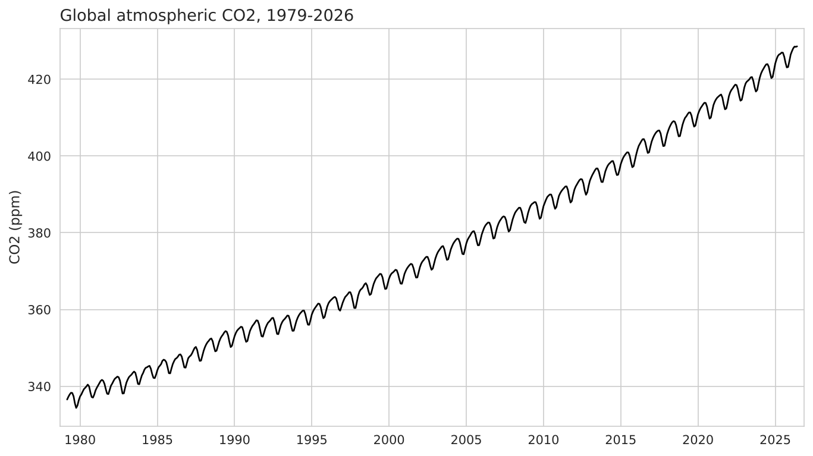

Submitted by: Ahmad Bahwerith - academy: @SDAIAAcademy

# Global CO2 Forecasting

Capstone for the SDAIA time series course. I forecast global monthly atmospheric CO2 instead of the AirPassengers default, since the brief allows a different series.

## Question

Which model should be shipped to forecast CO2 12 months ahead, and how far can its intervals be trusted?

## Dataset

Global monthly mean CO2 from NOAA GML (`co2_ppm`), 568 observations from March 1979 to June 2026, no gaps, frozen in `data/co2_global_monthly.csv` (`date`, `co2_ppm`). The latest months are provisional and get revised.

I chose it because it has a strong trend and a regular yearly cycle, which exposes the seasonal-naive floor: it repeats last year's season and misses the trend.

## Result

I compared five models (seasonal-naive floor, naive, random walk with drift, AutoETS, AutoARIMA) with rolling-origin cross-validation. AutoARIMA has the lowest MASE and CRPS over eight rolling 12-month windows (MASE 0.16 vs 1.37 for the floor), with AutoETS close behind (0.17). Full write-up in [report.md](report.md).

## Files

- `project.ipynb` is the notebook: data, exploration, floor, AutoGluon, harness.
- `report.md` is the report for a non-technical reader.
- `data/co2_global_monthly.csv` is the frozen data.
- `coursekit/` holds the course helper code for plotting and scoring.
- `brief.md` and `rubric.md` are the assignment.

## How to run

Open `project.ipynb` in Google Colab from GitHub (File → Open notebook → GitHub), then Runtime → Run all. The first cell clones the repo and installs the course package; the AutoGluon cell installs `autogluon.timeseries`.
