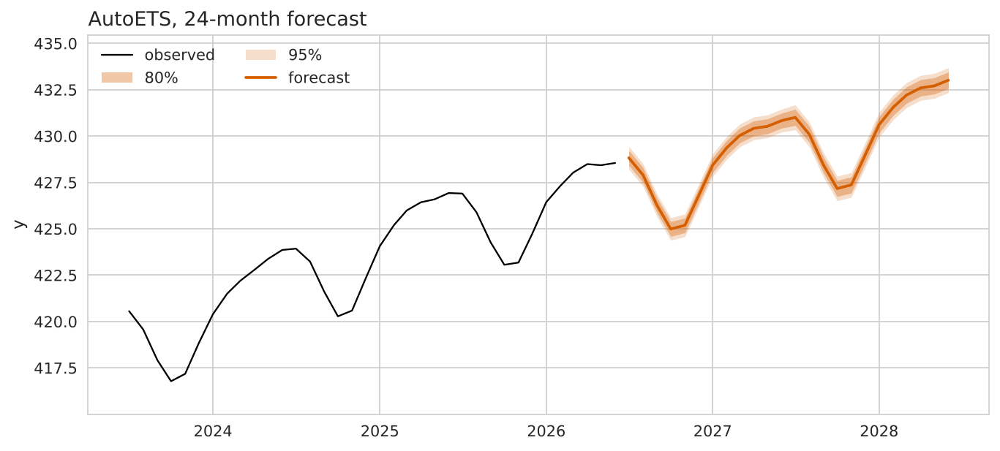

# Forecasting global atmospheric CO2: report

## Recommendation

Ship AutoARIMA. Over eight rolling 12-month forecasts its MASE is 0.16, against 1.37 for the seasonal-naive floor, about eight times more accurate than repeating last year's values. AutoETS is nearly as good (MASE 0.17); the choice between them rests mainly on the intervals and the bias, covered below.

The data is monthly global CO2 from NOAA GML: 568 months, March 1979 to June 2026. It rises steadily (about 337 to 429 ppm) with a yearly cycle of about 5 ppm, so a model needs both a trend and a season. The floor has the season but no trend, and that is why it loses.

| Model | MASE | CRPS | 80% coverage | 80% band width (ppm) |
|---|---|---|---|---|
| AutoARIMA | 0.16 | 0.0004 | 0.92 | 1.21 |
| AutoETS | 0.17 | 0.0005 | 0.75 | 0.89 |
| Random walk with drift | 0.92 | 0.0030 | 0.70 | 5.78 |
| Naive | 0.97 | 0.0027 | 0.75 | 5.82 |
| Seasonal naive (floor) | 1.37 | 0.0033 | 0.60 | 5.04 |

The gap holds in every window. AutoARIMA's worst window (MASE 0.30) beats the floor's best (1.17). A single holdout would have hidden this, so the comparison uses eight origins.

## The intervals

The 80% band for AutoARIMA averages 1.21 ppm wide, still narrow next to the 5 ppm yearly swing.

It errs on the cautious side. An 80% band should contain the truth 80% of the time and this one does so 92% of the time (and its 95% band always did). AutoETS errs the other way: its band is tighter (0.89 ppm) but covers only 75%. For planning, a band that is a little too wide is safer than one that is too tight. With only 96 forecast points, these coverage figures are imprecise.

## What the model missed

The floor's errors (this year minus last year) average +1.93 ppm, are almost always positive, and move slowly (lag-1 autocorrelation 0.96). This is the missing trend: the floor repeats last year and ignores the yearly rise. A model with an adaptive trend can absorb it, and both AutoARIMA and AutoETS do.

AutoARIMA has two remaining weaknesses:

- **Bias.** Its mean error is +0.07 ppm, so it tends to forecast very slightly low (AutoETS: +0.22 ppm).
- **Horizon.** Its average absolute error grows from 0.09 ppm one month ahead to 0.52 ppm twelve months ahead, roughly sixfold.

Both are small relative to the signal. The model is most reliable over the next few months and less so near the end of the year.

## Limits of this work

- The difference between AutoARIMA (MASE 0.16) and AutoETS (0.17) is small on eight windows, so I would not call it decisive. The preference for AutoARIMA comes from its smaller bias and its safer band.
- The most recent months of data are provisional and get revised, so the last windows carry extra uncertainty.

## One change

Calibrate the interval and re-check coverage. Scale the AutoARIMA band using the errors from the eight evaluation windows so it covers 80% instead of 92%. I expect the point forecast to stay the same (MASE about 0.16) and the band to get narrower, with coverage moving toward 0.80.
